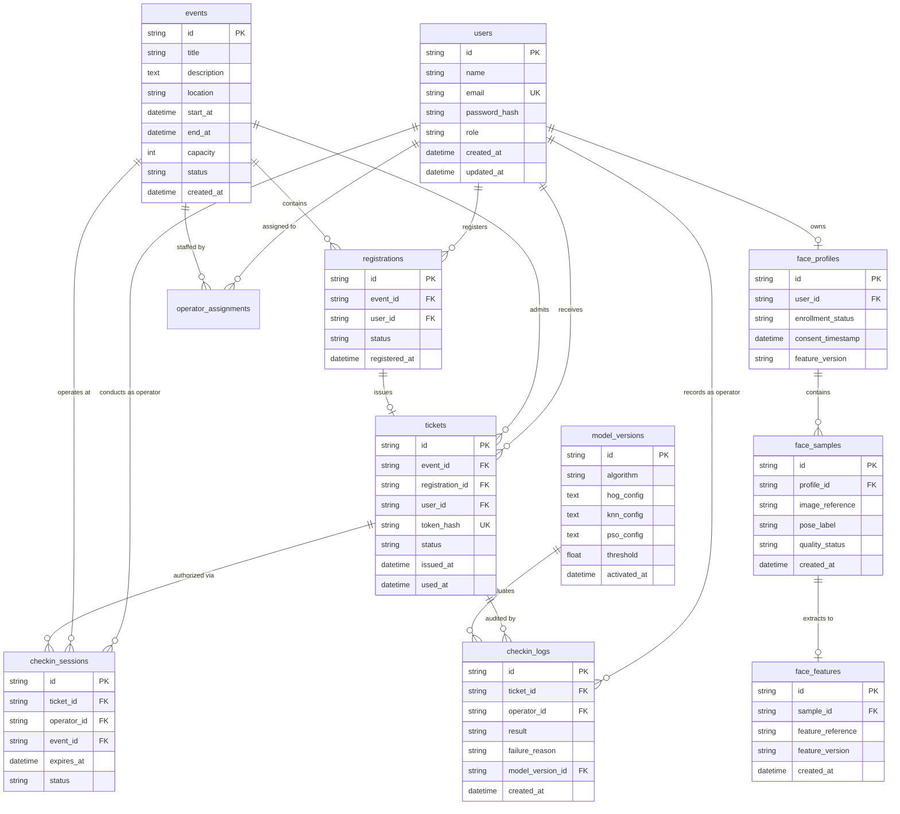

# Database Architecture & Entity Relationship Design

The database schema is implemented with SQLAlchemy 2.0 and supports MySQL 8.0 (using PyMySQL) and SQLite.

---

## 1. Entity-Relationship Diagram (ERD)

---

## 2. Table Specifications & Security Design

### `users`
* Primary identity store with role-based access control (`participant`, `operator`, `admin`).
* Passwords hashed using Argon2id with recommended parameters (time cost 3, memory cost 64MB, parallelism 4).

### `face_profiles`, `face_samples`, and `face_features`
* Decoupled from public user tables.
* Stores relative paths to private local storage (`storage/private_faces/` and `storage/features/`), ensuring raw biometric facial images are never exposed via public static URLs.
* Tracks consent timestamp and feature versions.

### `tickets`
* **Single-Use Enforcement:** Holds status enum (`ACTIVE`, `USED`, `CANCELLED`).
* **Token Protection:** The QR Code contains a 48-byte URL-safe cryptographic token. The database stores only the SHA-256 hash (`token_hash`), preventing token reconstruction from database dumps.
* **Atomic Consumption:** Updates from `ACTIVE` to `USED` are guarded by conditional update constraints, ensuring concurrent QR scans cannot enter the venue twice.

### `checkin_sessions`
* Ephemeral sessions with 3-minute sliding expirations preventing abandoned or hijacked scans.

