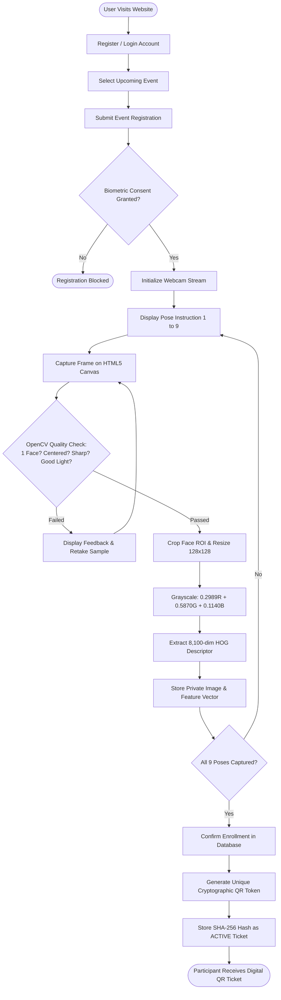
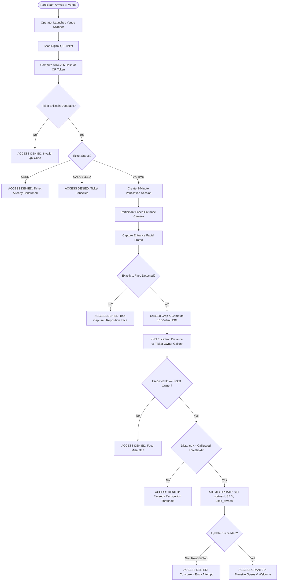
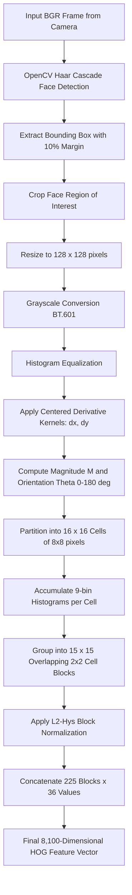
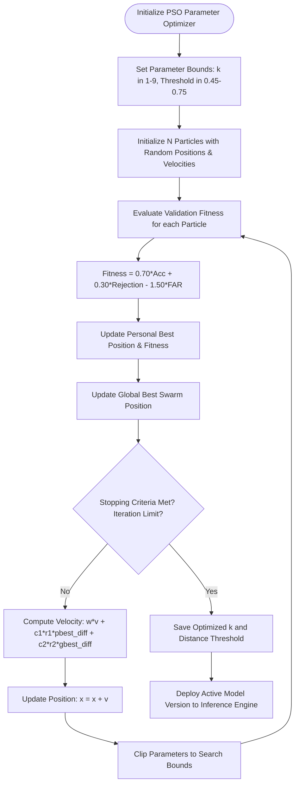

# System Workflow & Algorithm Flowcharts

---

## 1. Participant Registration & 9-Pose Facial Enrollment

---

## 2. Venue Entrance Check-In & Two-Factor Authentication

---

## 3. Computer Vision & HOG Descriptor Flowchart

---

## 4. Particle Swarm Optimization (PSO) Flowchart

